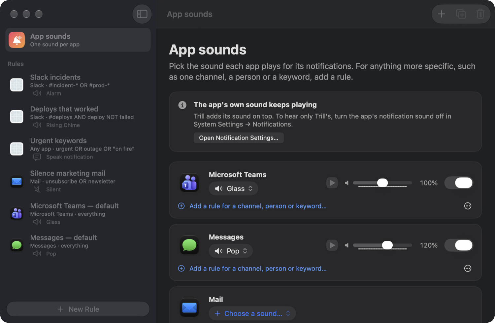
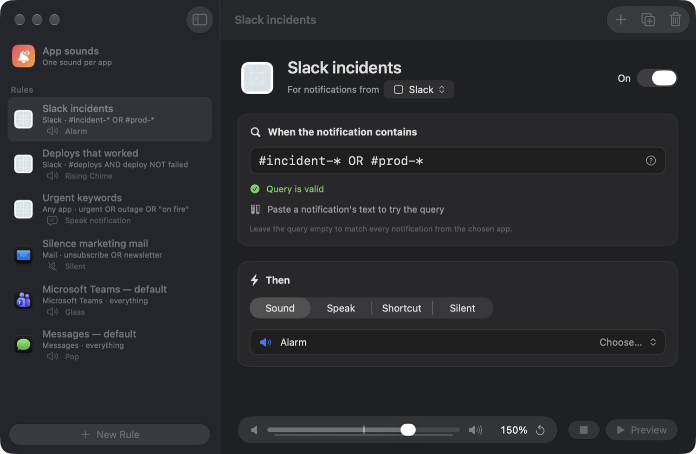
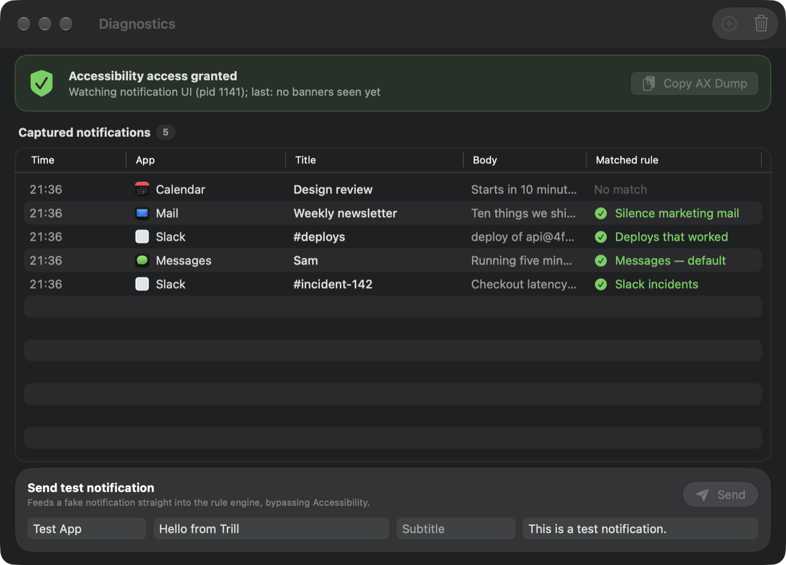

# Trill

**Give every Mac notification its own sound.**

macOS plays the same ping whether production is down or someone reacted in `#random`. Trill is a small
menu bar app that listens for notification banners and plays the sound *you* chose for each one, based
on rules you write: per app, channel, person or keyword.



## What it does

- **App sounds.** Trill finds the chat and mail apps you already have (Slack, Microsoft Teams, Discord,
  Messages, Mail, Outlook, WhatsApp and more) and lets you pick each one's notification sound, volume
  and on/off in one place.
- **Rules for the specifics.** For one channel, person or keyword, add a rule: an optional app, a
  query, an action and its own volume. Rules run top to bottom and the first enabled match wins.
- **A small query language.** `#incident-* OR #prod-*`, `#deploys AND deploy NOT failed`,
  `"on fire"`, `title:Sam`. Wildcards, quotes, parentheses, `AND` / `OR` / `NOT`.
- **Four actions.** Play a sound, speak the notification aloud in a voice you pick, run a Shortcut, or
  stay silent.
- **Volume per rule, up to 200%**, so an alert can cut through while chatter stays quiet.
- **Over 130 sounds.** 95 bundled sounds from three openly licensed packs, 24 synthesized on first
  launch, the macOS system sounds, any audio file you import, and "text to sound" (type a phrase, pick
  a voice, save it to your library).
- **Diagnostics.** See every notification Trill captured and which rule matched it, turn a missed one
  straight into a rule, and send test notifications.
- **Private.** Everything runs locally. Trill has no network code and does not talk to Slack, Teams or
  anyone else; it only reads the banner text macOS shows on screen.
- **Liquid Glass** on macOS 26 and later, with a plain-material fallback back to macOS 13.





## Install

1. Download `Trill.zip` from the [latest release](https://github.com/karimbacchus/Trill/releases/latest)
   and unzip it.
2. Move `Trill.app` to Applications and open it. The build is signed with a Developer ID and notarized
   by Apple.
3. Trill lives in the menu bar (waveform icon, no Dock icon). Click **Grant** in the Rules window and
   enable Trill under System Settings → Privacy & Security → Accessibility. This is how it reads
   notification banners.
4. Pick a sound for each app under **App sounds**. Trill plays its sound on top of the app's own, so to
   hear only Trill's, turn the app's notification sound off in System Settings → Notifications.

Requires macOS 13 or later. Built and tested on macOS 27, Apple Silicon.

## Writing rules

| Query | Matches |
|---|---|
| *(empty)* | every notification from the chosen app |
| `deploy` | text containing "deploy", ignoring case |
| `"on fire"` | the exact phrase |
| `#prod-*` | `#prod-eu`, `#prod-alerts`, … (`*` is any run of characters) |
| `#alerts AND deploy` | both; writing `#alerts deploy` means the same |
| `urgent OR outage` | either |
| `deploy NOT failed` | "deploy" without "failed" |
| `(a OR b) AND c` | grouping |
| `title:Sam`, `body:invoice`, `app:slack` | one field only |

`AND`, `OR` and `NOT` must be uppercase; in lowercase they are ordinary words. Unprefixed terms search
the title, subtitle and body. The editor validates the query as you type and has a "Test against text"
field.

Banners carry the app's display name but no bundle identifier, so Trill resolves the name against your
installed apps. A rule's app filter can be either the name ("Slack") or the bundle ID.

## Build from source

```sh
Scripts/build-app.sh         # release build -> build/Trill.app
Scripts/run.sh               # build, then open the app
swift run trill-selftest     # query language and rule engine tests
```

It is a plain Swift package: no Xcode project. Use the scripts rather than bare `swift build`: on
recent SDKs SwiftUI's `@State` needs a macro plugin that ships only inside Xcode.app, and the scripts
pass its path when Xcode is installed but not selected with `xcode-select`.

`build-app.sh` signs with a "Developer ID Application" identity if your keychain has one (override with
`TRILL_SIGN_IDENTITY`), otherwise ad-hoc. An ad-hoc build has a new identity every time, so macOS will
ask for Accessibility again after each rebuild.

```
Sources/TrillCore        models, query language, rule engine, persistence (Foundation only)
Sources/Trill/Services   notification watcher (Accessibility API), audio, speech, Shortcuts
Sources/Trill/UI, App    SwiftUI windows and the menu bar item
Sources/TrillSelfTest    tests, as an executable (XCTest needs Xcode)
```

Rules, settings and sounds are stored in `~/Library/Application Support/Trill`.

## Troubleshooting

- **Nothing plays.** Open Diagnostics from the menu bar. It shows whether Accessibility is granted and
  lists every captured notification. If a banner appeared on screen but is not in the list, use
  **Copy AX Dump** and open an issue with it; the banner layout differs between macOS versions.
- **A banner must appear.** Trill reads banners, so notifications hidden by a Focus mode or delivered
  silently to Notification Center are not seen.
- **Spoken notifications are capped at 100% volume**; the 200% boost applies to sounds.
- `Trill --dump-ax` prints the notification UI's accessibility tree and exits.
- `TRILL_DATA_DIR=/some/folder Trill --demo` runs against a separate data folder and feeds sample
  notifications through the rules (used to make the screenshots above).

## Sounds and credits

The bundled sounds are all CC0 (public domain); thank you to their authors. Details and licence texts
are in [Resources/Sounds/CREDITS.md](Resources/Sounds/CREDITS.md).

| Pack | Author | Source |
|---|---|---|
| Notification Tones | Aarni Koskela | [akx/Notifications](https://github.com/akx/Notifications) |
| Kenney Interface | Kenney | [kenney.nl](https://kenney.nl/assets/interface-sounds) |
| UI SFX | Yuki Capital / Romain Simon | [romainsimon/uisfx](https://github.com/romainsimon/uisfx) |

Trill is an independent project inspired by the idea behind [Chirpy](https://chirpy.pro). It shares no
code, sounds or artwork with it.

## License

[MIT](LICENSE). The bundled sound packs keep their own (CC0) licences.
